# MeroHisab — Personal Finance Management Application

> **Your Money. Your Goals. Your Control.**  
> *A private, local-first personal finance management application designed for everyday life in Nepal.*

[](docs/TESTING.md)
[](docs/TESTING.md)
[](LICENSE)
[-success.svg)](package.json)

---

## 1. Project Overview

**MeroHisab (मेरो हिसाब)** is a lightweight, local-first personal finance management web application designed to help individuals record, track, and analyze their personal financial life in Nepal.

Built entirely with standard native web technologies, MeroHisab operates **100% inside the user's web browser**. It requires no server infrastructure, no remote database, no user accounts or passwords, and no third-party API subscriptions. All financial records, account balances, budgets, savings milestones, and recurring schedules remain completely private on the user's device.

### Major Capabilities

- **Multi-Account & Wallet Ledger**: Track liquid balances separately across Cash, Bank accounts, eSewa, Khalti, and custom digital wallets.
- **Atomic Account-to-Account Transfers**: Move funds between wallets (e.g. Bank ATM cash withdrawal or Bank-to-eSewa top-up) with paired transfer legs that update balances while remaining neutral to income and expenses.
- **Dual Calendar Support (AD & BS)**: Native, astronomical Bikram Sambat (BS) calendar engine with bidirectional conversion to Gregorian (AD) dates.
- **Category Budgets with Visual Alerts**: Set monthly spending limits per category with three-tier visual feedback (Safe, Warning, Exceeded).
- **Savings Goals & Headroom Protection**: Allocate money toward savings targets using an earmarked reserve model that prevents double-deductions from the balance while strictly guarding liquid headroom.
- **Recurring Transactions & Bills**: Schedule repeating income and expense transactions with calendar day-of-month preservation, and track recurring bills with one-click payment linking.
- **Financial Analytics & Nepal Fiscal Year Reporting**: Interactive Canvas charts for monthly trends, category spending distribution, net cash flow, and Nepal Fiscal Year (Shrawan–Ashadh) aggregations.
- **Complete Data Portability**: Export transactions to RFC-compliant CSV with UTF-8 BOM, and create complete JSON backup snapshots with schema validation and one-click restoration.
- **Progressive Web App (PWA)**: Offline-first navigation and caching via Service Worker.

---

## 2. Verified Application Features

All documented features are verified in the actual codebase:

### Income & Expense Tracking
- Record income and expense entries with amount, category, description, payment channel, account, and synchronized AD/BS dates.
- Live South Asian number grouping with Nepali Rupee formatting (`रु 1,02,450.00`) and real-time Lakh/Paisa text preview while typing amounts.
- Multi-dimensional search and filtering (Type, Category, Payment Method, Date Range).

### Accounts & Balance Management
- Manage Cash, Bank, eSewa, Khalti, and custom wallets.
- Per-account balances calculated dynamically as:
  $$\text{Balance} = \text{Opening Balance} + \text{Inflow} - \text{Outflow} + \text{Inbound Transfers} - \text{Outbound Transfers}$$
- Per-account overdraft protection toggles.

### Account-to-Account Transfers
- Move funds between accounts atomically using two linked legs (`out`/`in`) sharing a unique `transferId`.
- Transfers update account balances but are strictly excluded from income, expense, and budget calculations.

### Monthly Budget Planning
- Configure category limits for any month (`YYYY-MM`).
- Prevents duplicate `(period, category)` combinations.
- Real-time utilization meters:
  - **Safe (`< 75%`)**: Emerald green meter.
  - **Warning (`75% – 99.99%`)**: Amber warning with overspending alert.
  - **Exceeded (`100%+`)**: Crimson alert indicating budget deficit.

### Savings Goals & Headroom Conservation
- Create financial targets with target amounts, target dates (AD/BS), and categories.
- **Earmarked Reserve Model**: Depositing money into a savings goal earmarks funds without counting as an expense or reducing the global ledger balance twice.
- **Headroom Protection**: Allocations are strictly limited to unallocated liquid funds:
  $$\text{Available to Allocate} = \text{Estimated Ledger Balance} - \text{Total Earmarked Savings}$$

### Recurring Transactions & Schedule Engine
- Define daily, weekly, monthly, and yearly recurring income/expense schedules.
- **Day-of-Month Preservation**: Scheduling an occurrence on the 31st advances to the last day of shorter months (e.g. Feb 28/29, Apr 30) without permanently losing the 31st anchor.
- Pause, resume, skip, or process due occurrences into real ledger transactions.

### Bill Management & Payment Tracking
- Track upcoming, due-soon, and overdue utility and personal bills.
- One-click bill payment with idempotent linking to a real expense transaction.

### Financial Analytics & Reports
- Nepal Fiscal Year (Shrawan 1 – Ashadh 31/32) and calendar month filtering.
- 4 custom HTML5 Canvas charts rendered with Retina/High-DPI scaling:
  1. Grouped Bar Chart: Monthly Inflow vs Outflow comparison.
  2. Donut Chart: Expense breakdown by category with center totals.
  3. Line Chart: Net cash flow trajectory series.
  4. Line Chart: Savings rate velocity trend.
- Nepal Payment Channel breakdown (Fonepay QR, eSewa, Khalti, Bank Transfer, Cash).

### Nepal Bikram Sambat (BS) Calendar
- Bidirectional astronomical conversion between Gregorian (AD) and Bikram Sambat (BS) across 21 calendar years (BS 2070 to BS 2090).
- Standardized to Nepal Standard Time (`Asia/Kathmandu`, UTC+05:45).

### Data Validation & Integrity Protections
- BigInt integer Paisa arithmetic eliminating IEEE 754 floating-point drift (`addMoney(0.1, 0.2) === 0.30`).
- Strict 2-decimal precision enforcement; rejection of 3-decimal values (e.g. `1.234`).
- Financial safety boundary: `MAX_MONEY_AMOUNT = 999,999,999,999.99` NPR.

### Local-First Data Storage & Portability
- Authoritative persistence in IndexedDB with synchronous LocalStorage mirror and verified fallback.
- Read-back SHA-256 state fingerprinting to prevent silent write corruption.
- Single-transaction atomic revision checking to eliminate multi-tab write races.
- Plain JSON backup export and schema-validated restore with entity-count confirmation.
- RFC-compliant CSV export with UTF-8 Byte Order Mark (BOM) for Microsoft Excel compatibility.

---

## 3. Technology Stack

MeroHisab is built strictly adhering to standard web standards with **zero runtime external dependencies**:

| Technology | Purpose in MeroHisab |
| :--- | :--- |
| **HTML5** | Semantic application layout (`<header>`, `<aside>`, `<main>`, `<nav>`, `<section>`). |
| **CSS3** | Modern CSS Custom Properties (Design Tokens), Flexbox, CSS Grid, media queries, high-contrast dark/light theme switching. |
| **Vanilla JavaScript (ES6+)** | Native ES Modules (`import`/`export`), class structures, asynchronous pipelines (`async`/`await`), state subscriptions. |
| **IndexedDB API** | Authoritative primary client database (`MeroHisabDB`, store: `app_state`). |
| **LocalStorage API** | Secondary mirror and verified offline fallback storage (`MERO_HISAB_STATE_V3`). |
| **HTML5 Canvas API** | Zero-dependency high-DPI custom charting engine (`window.devicePixelRatio`). |
| **Progressive Web App (PWA)** | Service Worker (`sw.js`) and Web App Manifest (`manifest.json`) for full offline navigation. |
| **Node.js (Built-in)** | Native assertion test runner (`tests/calendar.test.js`, `tests/domain.test.js`, `tests/financial-reference.test.js`). |
| **Chrome DevTools Protocol (CDP)** | Real headless Chrome browser automation for end-to-end integration workflows (`tests/e2e.test.js`). |

> **Strict Architectural Boundary**: The application contains no React, Vue, Angular, TypeScript, Node.js backend services, Express, Bootstrap, Tailwind, jQuery, or third-party charting libraries (such as Chart.js).

---

## 4. Architecture & Data Storage Model

```
┌────────────────────────────────────────────────────────────────────────┐
│                        User Web Browser Runtime                        │
│                                                                        │
│   ┌─────────────────┐       dispatch()        ┌────────────────────┐   │
│   │ UI Views & DOM  │ ──────────────────────> │ State Manager      │   │
│   │ (Dashboard, Tx, │                         │ (js/core/state.js) │   │
│   │  Accounts, etc) │ <────────────────────── │ (In-Memory Model)  │   │
│   └─────────────────┘       notify()          └────────────────────┘   │
│                                                          │             │
│                                                 enqueueAuthoritative   │
│                                                 Write()                │
│                                                          ▼             │
│                                               ┌────────────────────┐   │
│                                               │ Persistence Engine │   │
│                                               │ (migrate-to-idb)   │   │
│                                               └────────────────────┘   │
│                                                          │             │
│                                     ┌────────────────────┴───────────┐ │
│                                     │ Primary                        │ │
│                                     ▼                                ▼ │
│                          ┌────────────────────┐   Mirror   ┌─────────┐ │
│                          │ IndexedDB          │ ---------> │ Local   │ │
│                          │ (Authoritative)    │  Fallback  │ Storage │ │
│                          └────────────────────┘            └─────────┘ │
└────────────────────────────────────────────────────────────────────────┘
```

### Storage Architecture Details

1. **IndexedDB Authoritative Primary Store**:
   All state mutations are committed to IndexedDB (`MeroHisabDB`) first. Before committing, an atomic revision check verifies that no concurrent tab has advanced the revision. After writing, the state is read back and verified via content fingerprinting.
2. **LocalStorage Secondary Mirror & Verified Fallback**:
   A secondary copy is written to LocalStorage. If LocalStorage exceeds its browser quota or fails while IndexedDB succeeds, the mutation is still reported as successful. If IndexedDB is blocked or unavailable, verified LocalStorage acts as an emergency fallback.
3. **Zero In-Memory False Positives**:
   If both persistent stores fail or are unavailable, writes fail loudly. Volatile in-memory state is never reported as a durable save.
4. **Local-First Sandbox & Privacy**:
   All data lives exclusively inside the local browser storage partition.
5. **Backup Responsibility**:
   Because there is no remote cloud server, **users are responsible for exporting and preserving external backups**. Clearing browser site data, running private/incognito sessions, or device failure will permanently erase local browser storage if external backups have not been created.

---

## 5. Project Directory Structure

```text
MeroHisab/
│
├── assets/
│   └── icons/
│       └── favicon.svg          # Emerald Vector Favicon
│
├── css/
│   ├── main.css                 # Master CSS Orchestrator
│   ├── variables.css            # Color Tokens, Typography, Spacing & Themes
│   ├── reset.css                # CSS Reset & Normalization
│   ├── layout.css               # App Shell, Desktop Sidebar, Mobile Drawer & Header
│   ├── components.css           # Cards, Modals, Badges, Buttons, Toasts, Welcome Banner
│   └── responsive.css           # Viewport Breakpoints (Desktop >=1024px, Tablet 768px, Mobile <768px)
│
├── js/
│   ├── app.js                   # Application Bootstrap & Initialization
│   │
│   ├── core/
│   │   ├── constants.js         # Categories, Payment Channels, Defaults
│   │   ├── demo-data.js         # Mathematically Reconciled Nepal Demo Dataset
│   │   ├── migrate-to-idb.js    # Multi-Layer Storage Reconciliation & Fingerprinting
│   │   ├── state.js             # Central State Machine & Dispatch Controller
│   │   ├── storage.js           # LocalStorage Adapter with Fallback
│   │   └── validator.js         # v3 Entity, Transfer, Recurring, Bill & Backup Validators
│   │
│   ├── services/
│   │   ├── analytics.js         # Monthly & Nepal Fiscal Year Aggregations
│   │   ├── budgets.js           # Category Budget Utilization Analyzer
│   │   ├── goals.js             # Savings Milestones & Headroom Protection
│   │   ├── insights.js          # Heuristic Financial Pattern Analyzer
│   │   └── transactions.js      # Ledger Balance Math & Transaction Queries
│   │
│   ├── utils/
│   │   ├── canvas-charts.js     # Custom High-DPI Canvas Chart Engine
│   │   ├── file-io.js           # RFC-Compliant CSV & Strict JSON Backup Serialization
│   │   ├── formatters.js        # South Asian Lakh/Paisa & NPR Currency Formatters
│   │   ├── indexed-db.js        # Authoritative IndexedDB Adapter with Concurrency Control
│   │   ├── money.js             # Exact BigInt Integer Paisa Monetary Arithmetic
│   │   ├── nepali-calendar.js   # Astronomical Bikram Sambat (BS) & Gregorian (AD) Converter
│   │   └── storage-persistence.js # Storage Sync Coordination
│   │
│   ├── components/
│   │   ├── confirm-dialog.js    # Accessible Modal Confirmation Dialogs
│   │   ├── modal.js             # Dialog Traps & Modal Lifecycle Controller
│   │   ├── navigation.js        # Client-Side Hash Routing & Dynamic Header Date Badges
│   │   └── toast.js             # Toast Alert Notifications
│   │
│   └── views/
│       ├── accounts.js          # Accounts & Wallets View (CRUD & Transfers)
│       ├── analytics.js         # Financial Reports, Canvas Series & Payment Breakdown
│       ├── bills.js             # Bills Management & Idempotent Payment Flow
│       ├── budgets.js           # Monthly Budget Management with Utilization Meters
│       ├── dashboard.js         # Overview Dashboard, KPI Cards & Welcome Banner
│       ├── goals.js             # Savings Goals & Earmarked Deposit Allocations
│       ├── recurring.js         # Recurring Rules Management (Pause, Skip, Process)
│       ├── settings.js          # Preferences, Profile Name, Baseline & Data Portability
│       └── transactions.js      # Transaction Ledger with Search, Filters & Export
│
├── docs/
│   ├── screenshots/             # Application UI Screenshots for Documentation
│   └── TESTING.md               # Detailed Test Architecture & Verification Guide
│
├── screenshots/                 # High-Resolution Automated Viewport Captures
├── tests/
│   ├── calendar.test.js         # BS 2070–2090 Calendar Verification Suite
│   ├── domain.test.js           # Invariants, Transfers, Recurring, Bills, Audits 1–29
│   ├── financial-reference.test.js # Seeded Multi-Event Reference Engine Verification
│   └── e2e.test.js              # Headless Chrome DevTools Protocol Real-Browser E2E Suite
│
├── .gitignore                   # Repository Ignore Configuration
├── CONTRIBUTING.md              # Guidelines for Contributors
├── LICENSE                      # MIT Open-Source License Template
├── manifest.json                # PWA Web App Manifest
├── package.json                 # Project Metadata & Test Execution Scripts
├── README.md                    # Root Documentation
├── SECURITY.md                  # Responsible Vulnerability Disclosure Policy
└── sw.js                        # PWA Service Worker for Offline Navigation
```

---

## 6. Installation & Local Development

### Prerequisites

- Any modern web browser (Chrome, Firefox, Safari, Edge).
- **Node.js** (v18.0.0 or higher recommended, required for running tests).
- **Google Chrome** (required only if running the real-browser E2E suite via CDP).

### Running Locally

Because MeroHisab uses standard ES6 modules (`import`/`export`), opening `index.html` directly via the `file://` protocol will be blocked by browser CORS security policies. The project must be served via a local HTTP server.

```bash
# 1. Clone the repository
git clone https://github.com/<your-username>/merohisab.git
cd merohisab

# 2. Start a static HTTP server
# Option A: Using npx (Node.js)
npx serve .

# Option B: Using Python 3
python -m http.server 8000
```

Open `http://localhost:8000` (or the URL printed in your terminal) in your browser.

---

## 7. Testing & Verification

MeroHisab includes a comprehensive automated test harness covering dates, financial math, storage persistence, and browser UI workflows.

### Verified Test Results

| Test Suite | Purpose | Reported Result |
| :--- | :--- | :--- |
| **Calendar Suite** (`tests/calendar.test.js`) | Astronomical BS 2070–2090 bidirectional date conversions, New Year boundaries, gazetted years, and leap roll-over invariants. | **7,896 passed** |
| **Domain & Storage Safety Suite** (`tests/domain.test.js`) | Exact integer Paisa math, 2-decimal validation, two-legged transfers, recurring schedules, bill tracking, IndexedDB concurrency, read-back verification, and Audits 1–29. | **1,047 passed** |
| **Financial Reference Engine** (`tests/financial-reference.test.js`) | Monte-Carlo stress test across 5 deterministic seeds validating balances, cash flows, budgets, and headroom conservation against an independent engine. | **155 passed** |
| **Total Unit / Reference Checks** | *Combined unit, domain, and financial reference checks* | **9,098 passed checks** |
| **Real-Browser E2E Workflows** (`tests/e2e.test.js`) | 33 genuine user workflows executed in headless Chrome via Chrome DevTools Protocol (CDP), testing clean first-run initialization, modals, transfers, persistence across reloads, multi-tab concurrency, and PWA offline navigation. | **33 workflows passed** |

### Running the Tests

```bash
# Run all unit and reference tests (9,098 checks)
npm run test:unit

# Run independent financial reference engine tests (155 checks)
npm run test:ref

# Run real-browser E2E workflows (33 workflows via headless Chrome CDP)
npm run test:e2e

# Run the complete test suite (Unit + E2E)
npm test
```

> **Testing Scope Disclaimer**: While all 9,098 unit/reference checks and 33 browser workflows pass with zero errors, automated testing cannot guarantee the total absence of all possible bugs or environmental browser incompatibilities.

For in-depth details on the test architecture, consult [docs/TESTING.md](docs/TESTING.md).

---

## 8. Application Screenshots

The following genuine screenshots demonstrate the live application interface captured via headless Chrome:

### Clean Personal Ledger Welcome Banner (First Launch)

| Dark Theme | Light Theme |
| :---: | :---: |
| 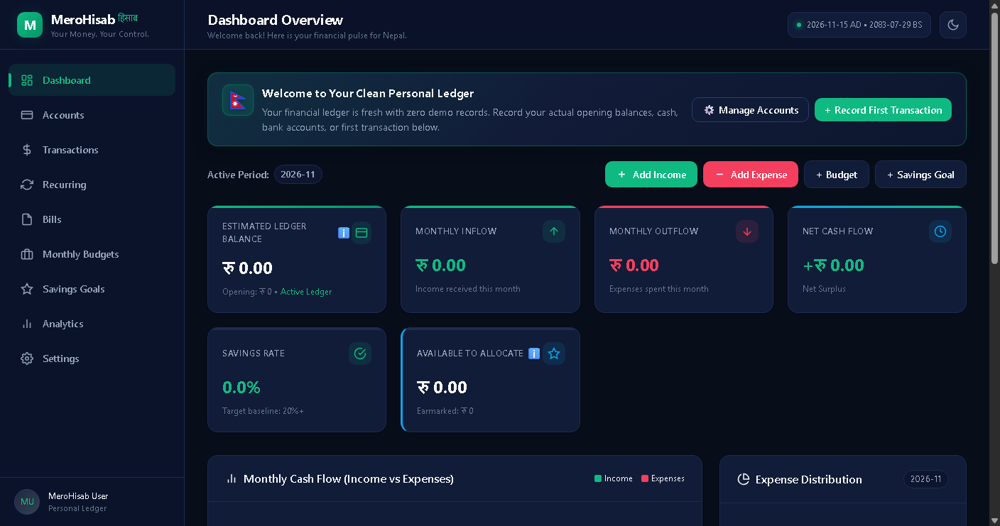 | 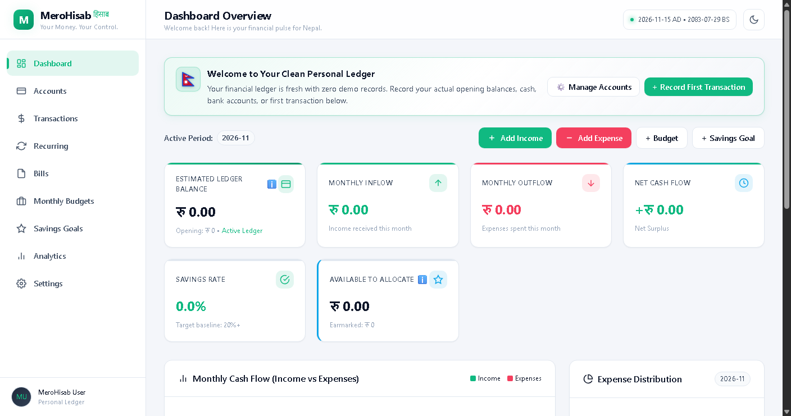 |

### Dashboard Overview (Dark Theme)

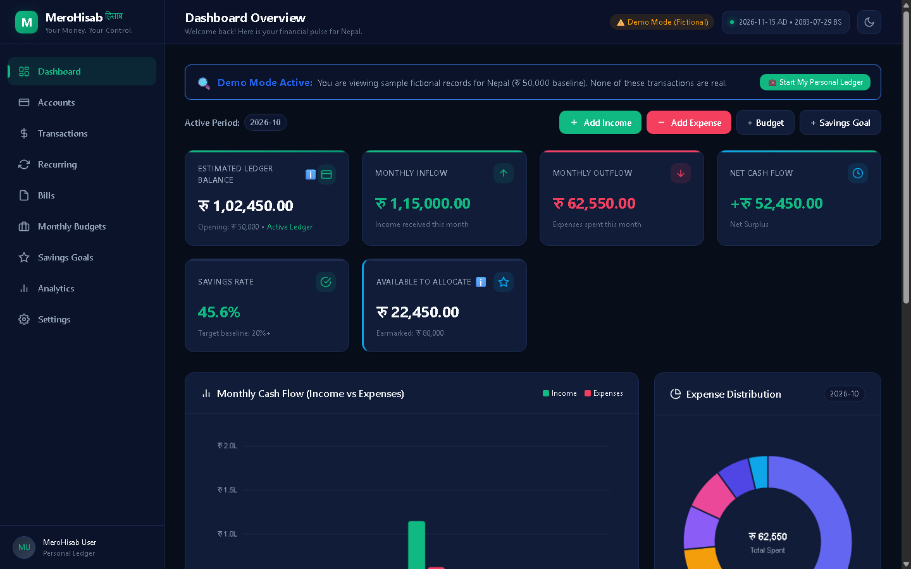

### Core Views & Management Interfaces

| Accounts & Wallets | Transactions Ledger |
| :---: | :---: |
| 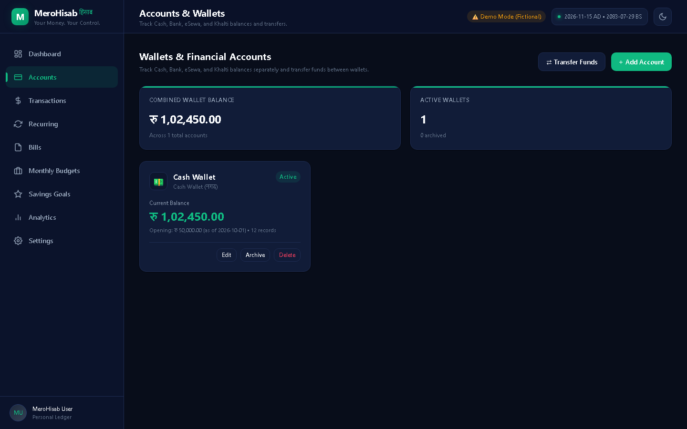 | 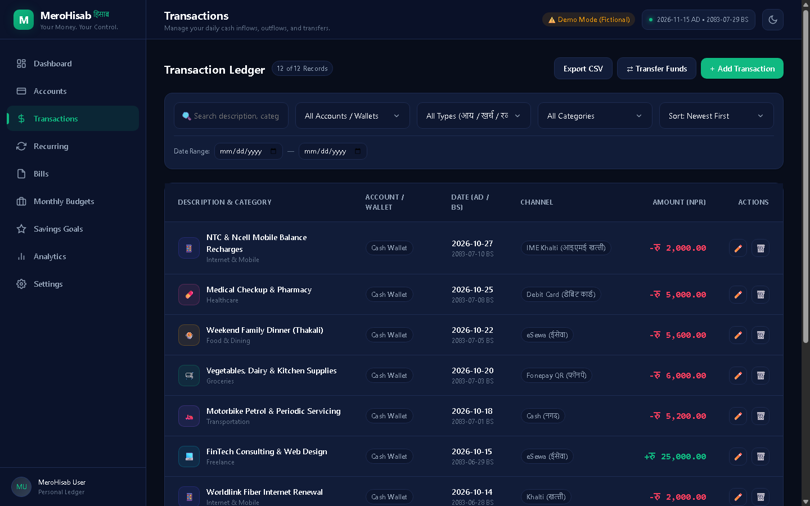 |

| Category Budgets | Savings Goals & Earmarks |
| :---: | :---: |
| 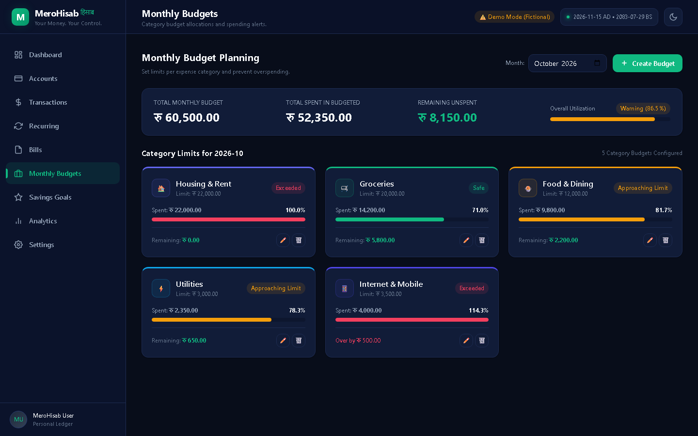 | 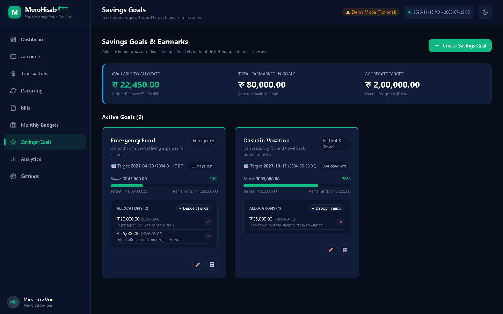 |

| Recurring Schedules | Bills & Due Tracking |
| :---: | :---: |
| 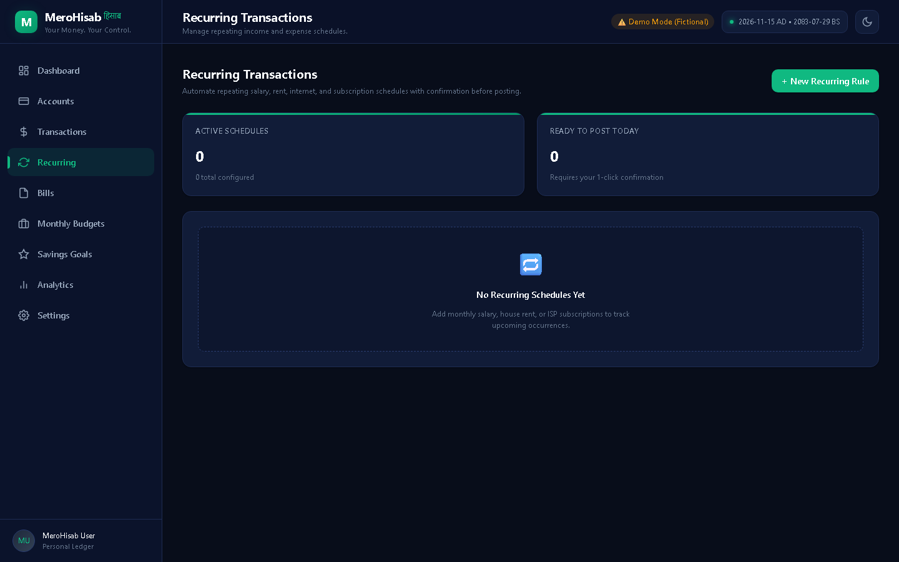 | 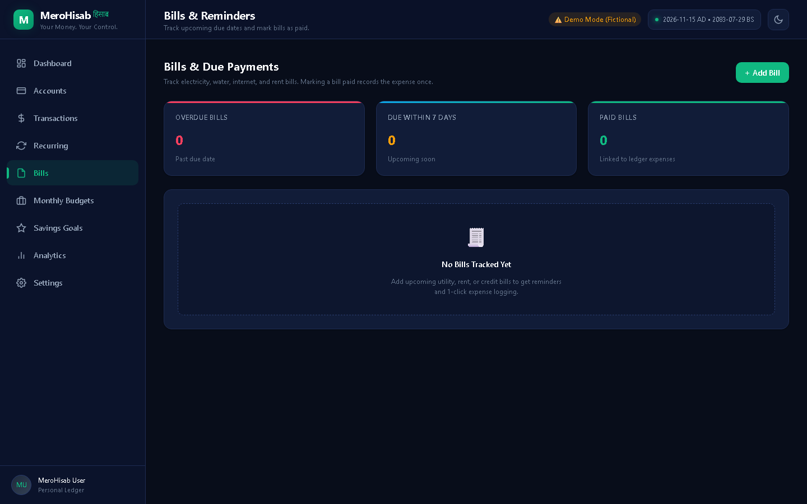 |

| Financial Analytics & Reports | Settings & Data Portability |
| :---: | :---: |
| 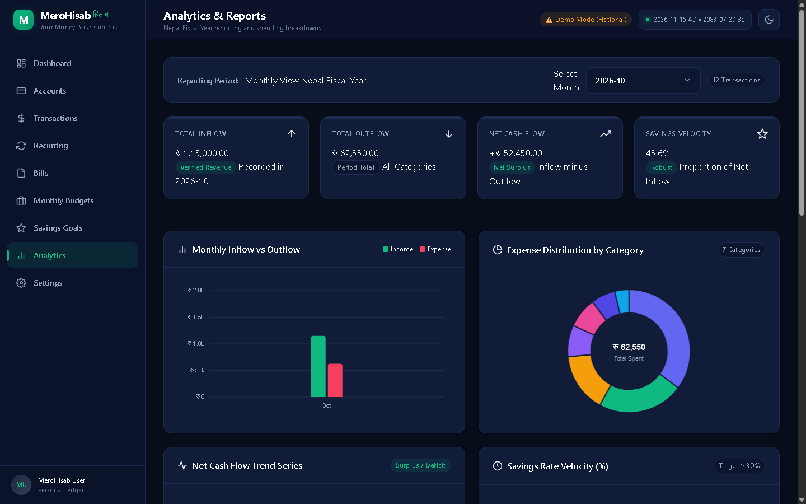 | 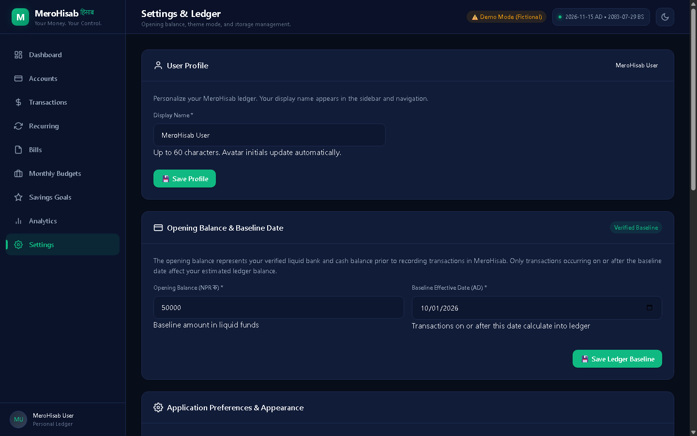 |

### Responsive Mobile & Tablet Layouts

| Tablet View (768px) | Mobile View (390px) |
| :---: | :---: |
| 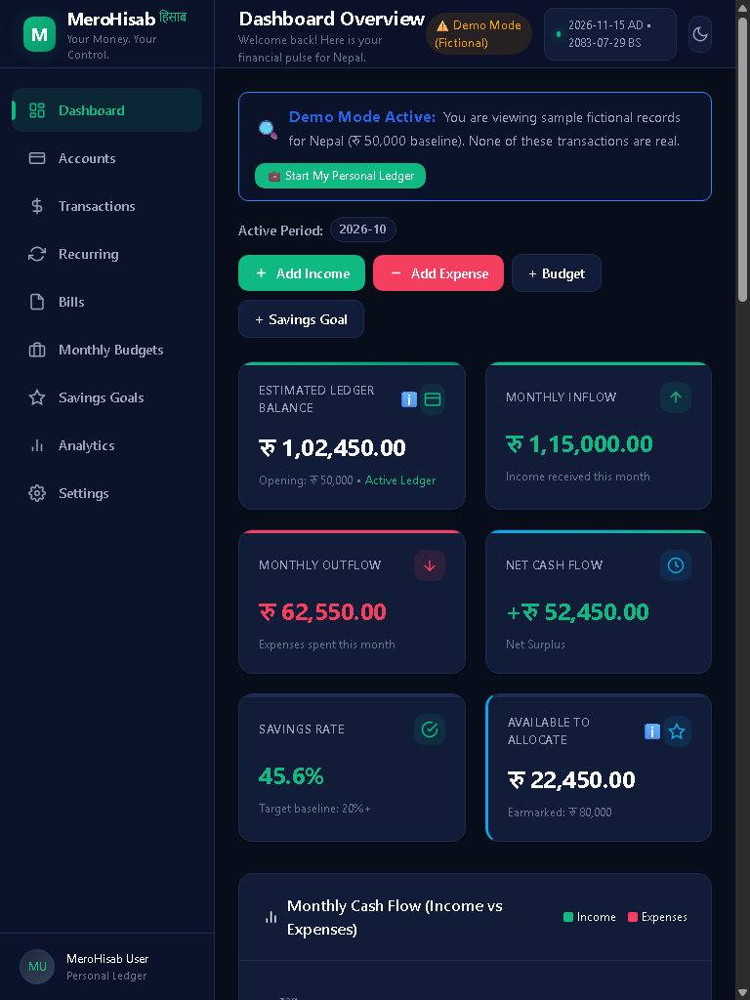 | 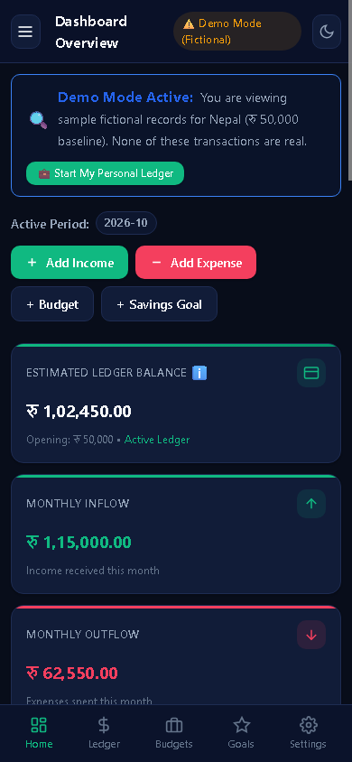 |

---

## 9. Data Safety & Known Limitations

Please review these important boundaries when using MeroHisab:

1. **Local-First Client Sandbox**:
   All financial data is stored directly in your browser's IndexedDB and LocalStorage. **There is no cloud database or remote backup.** If you clear your browser site data, reset your browser profile, or lose your device, your financial records will be permanently lost unless you have exported a JSON backup.
2. **No Automatic Bank or e-Wallet Synchronization**:
   MeroHisab does not connect to live banking APIs, SMS parsers, or payment gateways (such as Fonepay, connectIPS, eSewa, or Khalti). All transactions and balance adjustments are recorded manually or generated via local recurring schedules.
3. **No Multi-Device Automatic Synchronization**:
   Synchronizing data between multiple devices (e.g. desktop and mobile) requires downloading a JSON backup from the primary device and importing it on the secondary device.
4. **Single Currency Base**:
   All calculations are standardized to Nepalese Rupees (NPR / रु). Multi-currency conversion and live foreign exchange rates are not supported.
5. **Periodic Reconciliation Recommended**:
   Users should periodically compare their estimated ledger balances and account balances against their actual bank statements, cash counts, and digital wallet balances.

---

## 10. Roadmap & Potential Future Enhancements

The following items are potential future enhancements under consideration:

- [ ] **WebAuthn Biometric Lock**: Optional local PIN or biometric unlock (FaceID/TouchID/Windows Hello) using the Web Authentication API.
- [ ] **Receipt Image Attachments**: Storing compressed photo attachments of physical bills and payment receipts locally in IndexedDB Blobs.
- [ ] **Multi-Currency Support**: Secondary currency tracking (e.g. USD, EUR, INR) with user-defined exchange rates.
- [ ] **Custom Category Icons**: Ability to define custom spending categories and choose user-selected icons.
- [ ] **Enhanced PDF Statements**: Client-side generation of monthly and annual financial summary PDF statements.

---

## 11. Contributing

Contributions are welcome! Please read [CONTRIBUTING.md](CONTRIBUTING.md) for development setup guidelines, coding standards, exact Paisa arithmetic rules, and testing requirements before opening a pull request.

---

## 12. Security Policy

If you discover a security vulnerability or sensitive data handling issue, please review our [SECURITY.md](SECURITY.md) for private reporting instructions.

---

## 13. License

MeroHisab is prepared for open-source release under the **MIT License**.

The root [LICENSE](LICENSE) file provides the standard MIT license terms with a copyright holder placeholder (`[Author / Copyright Holder]`). The repository owner should confirm and insert their preferred copyright-holder name prior to publication.
